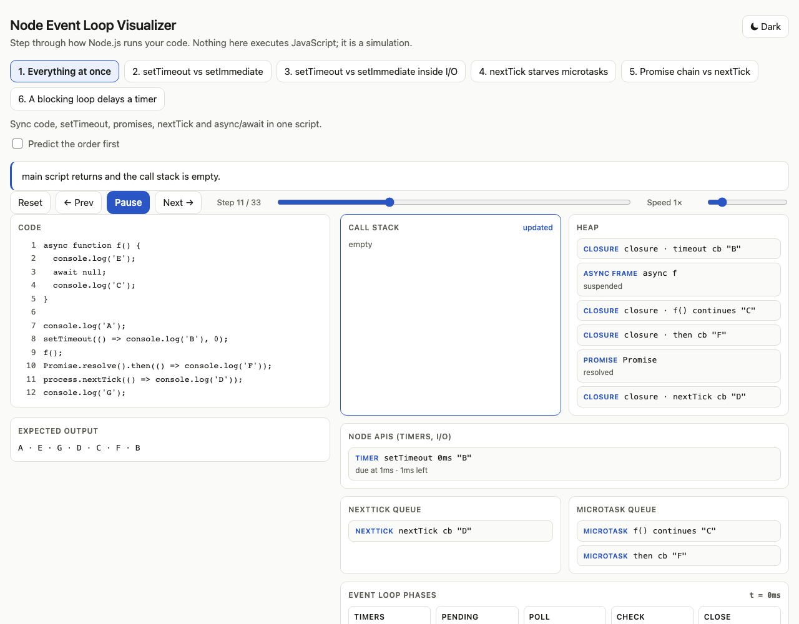

# Node Event Loop Visualizer

An animated, step-through simulation of how Node.js executes code: the call stack, `process.nextTick`, promise microtasks, and the libuv event loop phases. It runs entirely in the browser, with no backend.



**Features:** six curated scenarios, a "predict the order first" mode, step/prev/reset, auto-play with speed control, a scrubbable timeline, keyboard shortcuts (← → and Space), light/dark themes, reduced-motion support, and a layout that works down to 375px.

## Run it

```bash
npm install
npm run dev        # dev server
npm test           # engine + prediction tests
npm run typecheck && npm run lint
npm run build      # static output in dist/
```

Add `?scenario=<id>` to pick a scenario, and `?embed=1` to hide the header for iframe embedding.

## Architecture

```
src/engine/   pure TypeScript, no React: scenario ops in, array of Step snapshots out
src/scenarios/ typed scenario definitions
src/ui/       renders one Step; contains no event-loop logic
```

- `simulate(scenario, options)` is deterministic. It never parses or runs JavaScript; scenarios are a small typed op list (`log`, `setTimeout`, `setImmediate`, `nextTick`, `promiseThen`, `await`, `readFile`, `callFn`, `block`).
- Each `Step` is a full snapshot (call stack, heap, queues, phase, pending APIs, console, caption) plus `highlight` regions and a `moved` hint that drives the slide animations. Cards share a stable id across steps, so Framer Motion animates them between regions.
- The UI only reads steps. Prev/scrub is just an index into the array.

Engine rules: the stack must be empty before any queue runs; after the script and after every callback, nextTick drains fully, then microtasks, repeating until both are empty; phases run timers → pending → poll → check → close; inside an I/O callback `setImmediate` runs before `setTimeout`.

## Add a scenario

Add an object to `src/scenarios/index.ts` and append it to `scenarios`:

```ts
const example: Scenario = {
  id: 'example',
  title: 'My scenario',
  summary: 'One sentence.',
  code: ["setImmediate(() => console.log('x'));"], // display only
  ops: [{ op: 'setImmediate', line: 1, body: [{ op: 'log', text: 'x', line: 1 }] }],
  expectedOutput: ['x'],
};
```

`line` is the 1-based line in `code` to highlight. `await` must be the last op of an `async` `callFn`. Add the scenario's expected output to the tests; `simulate.test.ts` already loops over every scenario.

## Known simplifications

- Single thread only; no worker threads, no `cluster`.
- No real I/O: `readFile` completes after a fixed 5ms of virtual time. Timers and the clock are simulated, not wall-clock.
- `setTimeout(fn, 0)` is clamped to 1ms, as in Node.
- The `pending` and `close` phases are never populated and are skipped silently.
- Top-level `setTimeout(0)` vs `setImmediate` is genuinely non-deterministic in Node; the toggle picks one outcome.
- `await` models an already-resolved value (one microtask hop).

## Deploy

Pushes to `main` run lint, typecheck, tests and build, then deploy to GitHub Pages (`.github/workflows/deploy.yml`).
